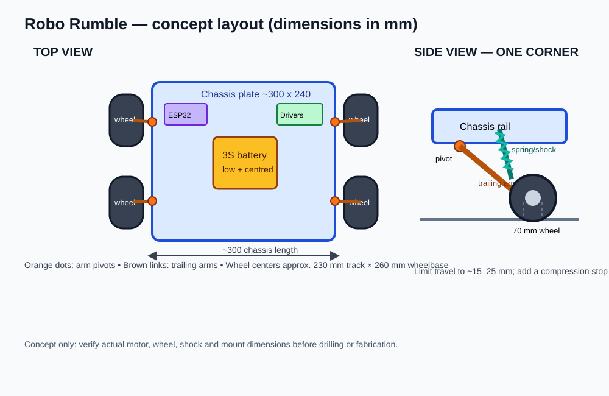
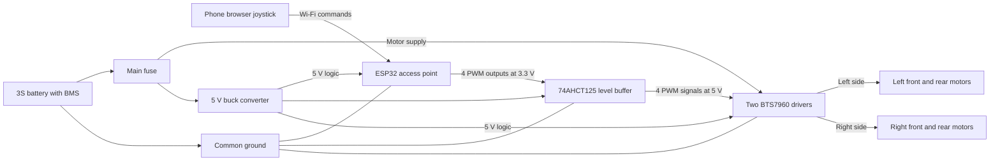

# System design

## Mechanical layout and weight distribution

The rover uses four driven wheels on independent trailing arms. Battery mass is kept low and close to the center of the chassis; this lowers the centre of gravity (CG) and avoids making the rover front-heavy or side-heavy. The controller and drivers are light, so they can sit above the battery on insulated mounts. Motors remain at the four corners because they drive the wheels; place them symmetrically.

The drawing is a layout concept, not a manufacturing drawing. Confirm actual part dimensions before drilling.

### Weight optimization and CG centralization

- Use a light but stiff chassis: 3 mm plywood for a low-cost first build, or 2-3 mm aluminium with cross-bracing where needed. Remove material only where it does not weaken motor, arm, battery, or shock mounts.
- Avoid excess brackets, tall covers, heavy decorative parts, and long loose wires. Route cables neatly and use only enough material to resist bending and impacts.
- Put the heaviest single part, the battery, low and near the geometric centre. Keep left/right and front/rear parts mirrored as far as practical.
- Mount the ESP32, buffer, and drivers on a compact upper plate above the battery; do not stack heavy parts high.
- Keep track and wheelbase wide enough for stability without making the robot unnecessarily heavy or too wide for the fest course.
- Do not add ballast as the first fix for imbalance. Move the battery or other existing parts first; extra mass raises motor load and can increase rollover energy.

For each part, record its mass and position from the chassis centre. Estimate the CG with `xCG = Σ(mᵢxᵢ)/Σmᵢ`, `yCG = Σ(mᵢyᵢ)/Σmᵢ`, and `zCG = Σ(mᵢzᵢ)/Σmᵢ`. Keep x and y near zero; make z as low as practical. The battery contributes most, so its position has the biggest effect.

**Physical balance check:** assemble the rover with its battery and normal payload. Weigh the left and right sides, then front and rear, using two scales at a time. Similar readings indicate the CG is near the middle. If one side or end is heavier, shift the battery or electronics and measure again. Secure the pack so it cannot slide during driving. Repeat after adding the roll hoop or recovery hardware.

## System block diagram

The signal path and motor-power path are separate. Only the control signals pass through the ESP32 and logic buffer; motor current comes directly from the fused battery branch.

## Mechanical and control subsystems

- **Mobility:** four 12 V geared motors, 4WD skid steering, rubber-tread wheels.
- **Suspension:** four spring/damper trailing arms with limited travel and bump stops.
- **Control:** ESP32 access point hosts the phone joystick; the firmware mixes throttle and steering into left/right motor commands and stops after command loss.
- **Power:** fused 3S battery supplies the motor drivers; a separate buck converter provides 5 V logic power.
- **Stability:** low, centered battery; balanced front/rear and left/right mass; wide wheel track; moderate speed; protective roll hoop.

## How the suspension reduces rollover risk

Trailing arms let the wheels follow uneven ground and maintain tire contact. Springs and damping soften sharp impacts that can bounce the chassis sideways. A low CG and wide track increase the support margin while the suspension reduces sudden wheel lift. Set spring preload moderately and limit travel: excessive body lean from a soft suspension can make rollover easier. Passive suspension cannot guarantee no rollover and cannot right a fully inverted robot; active recovery requires a separate mechanism.

A rough static comparison is `critical tip angle ≈ tan inverse(track / (2 × CG height))`, where **tan inverse** (also written `atan` or `tan⁻¹`) converts the ratio into an angle. With 230 mm track and 90 mm CG height, the idealized result is about 52°. Motion, suspension lean, and tire grip reduce the real margin; use the formula for comparing layouts, not as a safe operating limit.

See [hardware plan](hardware-plan.md), [wiring diagram](wiring-diagram.md), and [test log](test-results.md) for build details and measurements.

