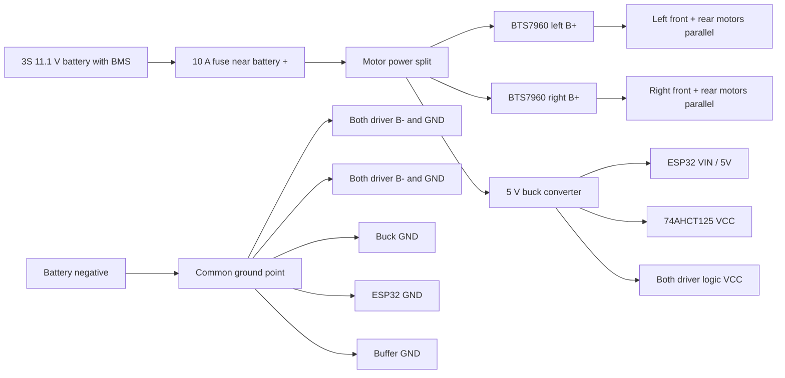
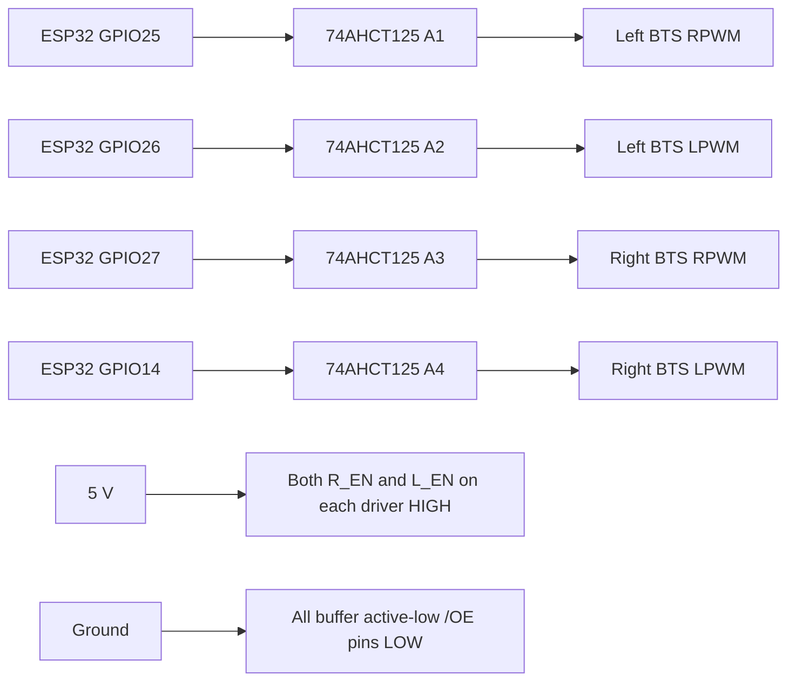

# Wiring diagram

Assumed hardware: two BTS7960 modules (one per side), four 12 V motors, a 3S battery, 5 V buck converter, and one 74AHCT125 buffer. Confirm labels on your exact modules.

## Power wiring

## Control signals

## Pin table

| ESP32 / supply | Connection |
|---|---|
| GPIO25 | Buffer A1; buffer Y1 to left driver RPWM |
| GPIO26 | Buffer A2; buffer Y2 to left driver LPWM |
| GPIO27 | Buffer A3; buffer Y3 to right driver RPWM |
| GPIO14 | Buffer A4; buffer Y4 to right driver LPWM |
| 5 V buck output | ESP32 VIN/5V, buffer VCC, both driver VCC, each driver's R_EN and L_EN HIGH |
| Common ground | ESP32 GND, buffer GND, driver logic GND and B-, buck GND, battery negative |
| Fused battery positive | Both driver B+ and buck input positive |
| Left driver M+/M- | Left-front and left-rear motors in parallel |
| Right driver M+/M- | Right-front and right-rear motors in parallel |

The 74AHCT125 buffers ESP32 3.3 V PWM to 5 V logic because clone BTS7960 boards may use 5 V logic buffers. Tie all four active-low `/OE` inputs to ground. Do not connect battery voltage to an ESP32 pin. If a wheel spins backward relative to its partner on that side, swap that motor's wires. If forward/reverse is reversed, swap both motors on that side or invert that side in firmware. Keep motors on a side wired in parallel, never series.

